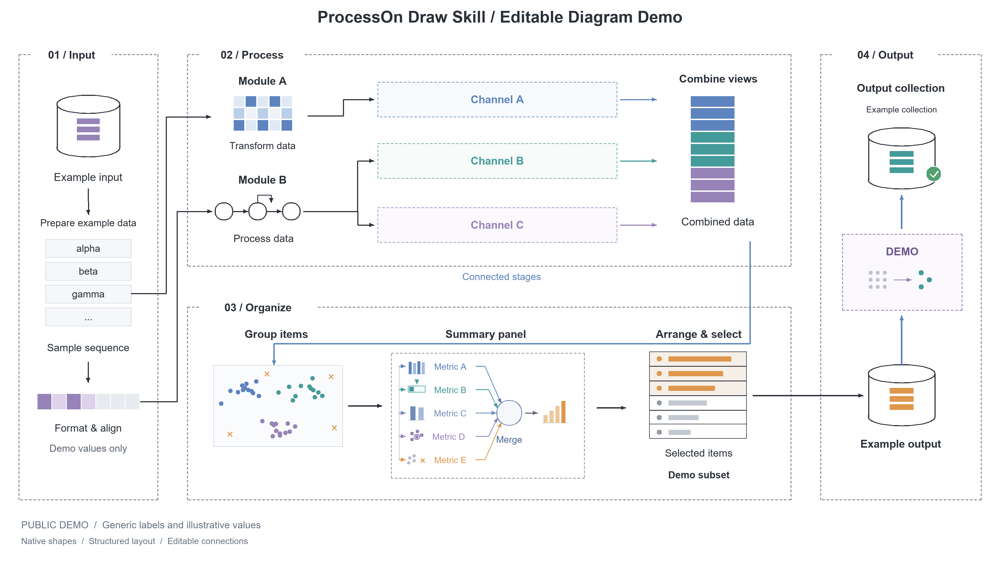

# ProcessOn Draw Skill

**用自然语言创建和修改 ProcessOn 图表，让 AI 完成布局、连线和文字调整，得到可以继续编辑的原生图形。**

`processon-draw` 是一个面向 Codex 的绘图技能，包含操作说明、Python API 客户端和图形构建工具。它通过 ProcessOn Web API 读取和保存图表，适合绘制流程图、算法示意图、架构图，以及修改已有图表。

你可以描述想要的图，也可以指定已有文件，让 AI 调整节点、配色、布局或公开展示用的文字。

## 效果展示

下面是使用该技能修改的公开演示图：保留模块分区、配色、图形和连接关系，将研究相关的文字与公式替换为通用示例标签。



这个示例包含 **261 个原生图形元素**，展示了多模块布局、数据流连接、矩阵、分组散点和指标面板。保存到 ProcessOn 后，节点、文字和连接线仍可继续编辑。

[查看高清 PNG（3680 × 2080）](docs/images/processon-skill-demo.png) · [查看 SVG 矢量图](docs/images/processon-skill-demo.svg) · [查看示例 JSON](examples/processon-skill-demo.json)

> PNG 和 SVG 是本仓库随附的展示资源。内置 `render_def.py` 用于生成本地 PNG 预览，不是完整的 ProcessOn 导出引擎。

## 能做什么

| 场景 | 用法 |
| --- | --- |
| 从描述生成图表 | 将算法步骤、业务流程或模块关系组织成图形与连线 |
| 修改已有图表 | 读取目标文件，调整文字、颜色、坐标和图形结构 |
| 制作公开展示版本 | 根据你的要求，将专有术语、公式和参数改为通用标签 |
| 重复使用图形结构 | 通过 Python 构建节点、箭头、连接线和注释 |
| 检查保存结果 | 保存后重新读取，核对元素数量和内容 |

当前实现主要面向 ProcessOn 的**流程图画布**。思维导图专用格式、分享权限设置和 ProcessOn AI 生成功能不在当前支持范围内。

## 安装

### 1. 获取仓库与运行环境

需要 Python 3、可访问 ProcessOn 的网络环境，以及拥有目标文件编辑权限的 ProcessOn 账号。本示例使用 Python 3.13 验证。

```bash
git clone https://github.com/Xhcgks211/ProcessOn_DrawPic.git
cd ProcessOn_DrawPic
python -m pip install Pillow
```

API 客户端使用 Python 标准库；`Pillow` 用于本地预览。只使用文件列表、读取和保存等 API 功能时，可以不安装 Pillow。

### 2. 将技能添加到 Codex

可以直接在 Codex 中输入：

```text
$skill-installer 请安装 GitHub 仓库 Xhcgks211/ProcessOn_DrawPic 中 processon-draw 目录下的技能。
```

也可以手动将整个 `processon-draw` 文件夹复制到个人技能目录 `~/.agents/skills/`。

**Windows PowerShell**，在仓库根目录执行：

```powershell
New-Item -ItemType Directory -Force "$HOME/.agents/skills" | Out-Null
Copy-Item -LiteralPath ./processon-draw -Destination "$HOME/.agents/skills/processon-draw" -Recurse
```

**macOS / Linux**，在仓库根目录执行：

```bash
mkdir -p "$HOME/.agents/skills"
cp -R ./processon-draw "$HOME/.agents/skills/processon-draw"
```

复制前确认目标目录尚未安装同名技能。只想在某个项目中使用时，也可以放到该项目的 `.agents/skills/processon-draw/`。安装后若未显示，重启 Codex。安装位置和发现机制参见 [OpenAI 官方技能文档](https://learn.chatgpt.com/docs/build-skills)。

### 3. 配置 ProcessOn 登录凭证

登录 [ProcessOn](https://www.processon.com/)，在浏览器开发者工具的 **Application / 应用程序 → Cookies** 中找到 `www.processon.com` 的 `token` Cookie，复制它的值。

在运行脚本的终端中配置环境变量。**仅填入 token 的值，不包含 `token=` 前缀。**

**PowerShell：**

```powershell
$env:PROCESSON_TOKEN = Read-Host "请输入 ProcessOn token"
$env:PROCESSON_COOKIE = "po-last-platform=personal"
```

**Bash：**

```bash
read -r -s -p "ProcessOn token: " PROCESSON_TOKEN
export PROCESSON_TOKEN
export PROCESSON_COOKIE="po-last-platform=personal"
```

`PROCESSON_COOKIE` 用于补充其他 Cookie，例如会话需要的 `token.sig`，格式为 `k=v; k2=v2`。让 Codex 执行时，也要确保它运行脚本的环境能够读取这些变量。

登录凭证只用于当前操作，不应写入源码、示例 JSON、README 或 Git 提交。凭证过期后需要重新获取。

## 使用方式

### 使用技巧

**1. 第一次绘图时，一定要明确想要的图像风格。**

在首次请求中说明布局、配色和图形风格，也可以直接使用本仓库内置的 [Demo 图](docs/images/processon-skill-demo.png) 作为风格参考，并提供 [示例 JSON](examples/processon-skill-demo.json) 供 AI 参考图形结构。

```text
使用 $processon-draw，参考仓库内置 Demo 图的风格绘制我的算法流程图：
采用横向分区布局、浅色配色、统一字号和简洁连线。
参考 docs/images/processon-skill-demo.png 的视觉效果，
以及 examples/processon-skill-demo.json 的图形结构，内容替换为以下算法步骤：……
```

**2. 当算法公式或文字描述过多时，要求减少文字和公式，用抽象图形代替。**

可以让 AI 用矩阵、散点、模块、箭头等图形表达数据与操作，只保留必要的短标签和关键公式，让流程与模块关系更容易看清。

```text
这张图的文字描述和算法公式太多，请进一步简化：
减少长段文字与非必要公式，用矩阵、散点、模块和箭头等抽象图形表达，
只保留必要的短标签与关键公式，并保持算法步骤和数据流关系准确。
```

### 在 Codex 中用自然语言操作

安装技能并配置凭证后，指定目标文件或描述新图即可。可以显式使用 `$processon-draw` 调用：

**创建流程图：**

```text
使用 $processon-draw，在 ProcessOn 创建一张数据处理流程图：
输入数据 → 数据校验 → 数据转换 → 输出结果。
使用横向布局，各阶段用不同的浅色区分，先生成本地预览，再保存并核对结果。
```

**修改已有图表：**

```text
使用 $processon-draw，找到 ProcessOn 中名为“演示流程”的文件。
将输入节点改成蓝色，统一字号，并调整节点间距，让连接线避开文字。
修改前备份原图，保存后重新读取核对。
```

**制作 GitHub 展示版本：**

```text
使用 $processon-draw，修改我指定的图表。
将论文方法名、公式、关键参数和专有术语替换为通用示例，
保留图形布局与配色，生成适合 GitHub README 展示的图片。
```

### 直接运行命令行

以下命令都在**本仓库根目录**执行。先查看文件列表，取得目标文件的 `chartId`：

```bash
python processon-draw/scripts/po_draw.py list
```

PowerShell 操作示例：

```powershell
$chartId = "替换为目标文件的 chartId"

# 下载整张图的定义，备份放在仓库外
python processon-draw/scripts/po_draw.py get $chartId ../processon-original-backup.json

# 预览随仓库提供的公开示例，无需登录
python processon-draw/scripts/render_def.py examples/processon-skill-demo.json preview.png

# 将完整示例写入目标文件：会替换该文件当前的整张图
python processon-draw/scripts/po_draw.py put $chartId examples/processon-skill-demo.json

# 再次下载，核对保存后的元素和文字
python processon-draw/scripts/po_draw.py get $chartId roundtrip.json
```

`put` 写入的是完整图表定义。修改局部节点时，应先下载整张图，在其基础上修改，再上传完整 JSON。

### 常用命令

| 命令 | 功能 |
| --- | --- |
| `python processon-draw/scripts/po_draw.py list` | 列出文件及其 ID |
| `python processon-draw/scripts/po_draw.py quota` | 查看文件配额 |
| `python processon-draw/scripts/po_draw.py new "演示流程"` | 创建流程图文件 |
| `python processon-draw/scripts/po_draw.py get <chartId> drawing.json` | 下载图表定义 |
| `python processon-draw/scripts/po_draw.py put <chartId> drawing.json` | 保存完整图表定义 |
| `python processon-draw/scripts/po_draw.py rename <chartId> "新名称"` | 修改文件名 |
| `python processon-draw/scripts/po_draw.py thumb <chartId> thumbnail.png` | 获取服务器缩略图 |
| `python processon-draw/scripts/po_draw.py apple apple.json` | 生成本地苹果图形示例，无需登录 |
| `python processon-draw/scripts/render_def.py drawing.json preview.png` | 渲染本地 PNG 预览 |

表中的 `<chartId>` 是占位符，执行前替换为实际文件 ID。

## 工作流程

```text
理解绘图要求 → 定位文件并备份 → 构建或修改完整 JSON
    → 本地预览 → 写入 ProcessOn → 回读核对 → 提供图表链接
```

图表通过原生图形定义构建，节点位置、尺寸、颜色、文字和连接关系均保存在 JSON 中。更多用法见 [绘图配方](processon-draw/references/recipes.md) 和 [API 参考](processon-draw/references/api.md)。

## 已知限制与排查

| 情况 | 说明与处理 |
| --- | --- |
| 保存返回 `406` | 当前客户端默认将 `chartId` 用作 `canvasId`。部分文件的实际画布 ID 不同，需要通过 `Client.chart_meta(chartId)` 取得 `canvas.mainCanvasId`，并据此调整保存请求。本仓库展示图保存时使用了实际画布 ID。 |
| 返回成功但内容没变 | 检查版本号，并重新读取图表。当前 `save_def()` 默认依据图表元数据递增版本；若定义中的版本更高，需要显式传入更大的 `version`。 |
| API 修改后被覆盖 | 已打开的编辑器可能自动保存旧状态。API 修改期间关闭对应编辑页，完成后重新打开或刷新。 |
| 缩略图仍是旧内容 | 服务器缩略图可能延迟更新；通过回读定义检查保存结果。 |
| 创建失败，返回 `815` | 检查文件配额；回收站中的文件也可能占用配额。 |
| 持续鉴权失败 | 更新 `token`，必要时补充其他会话 Cookie，并确认目标文件编辑权限。 |
| 本地预览与编辑器显示不同 | 内置渲染器是简化实现，字体、公式、文字对齐及部分图形效果可能存在差异；中文字体需要按运行环境配置。 |

本项目使用 ProcessOn Web API，接口变化时可能需要适配。当前示例的画布 ID 和版本处理经验应与代码及 API 参考结合使用。

## 仓库结构

```text
ProcessOn_DrawPic/
├── README.md
├── processon-draw/
│   ├── SKILL.md                  # 技能入口与操作流程
│   ├── agents/openai.yaml        # 技能展示配置
│   ├── references/
│   │   ├── api.md                # API 与图形定义参考
│   │   └── recipes.md            # 图形组合示例
│   └── scripts/
│       ├── po_draw.py            # 命令行入口
│       ├── processon_api.py      # API 客户端与基础图形
│       ├── shapes.py             # 节点、连接线与标签工具
│       └── render_def.py         # 本地 PNG 预览
├── examples/
│   └── processon-skill-demo.json # 公开演示图的可编辑定义
└── docs/images/
    ├── processon-skill-demo.png  # README 高清展示图
    └── processon-skill-demo.svg  # SVG 展示图
```
